<p align="center">
  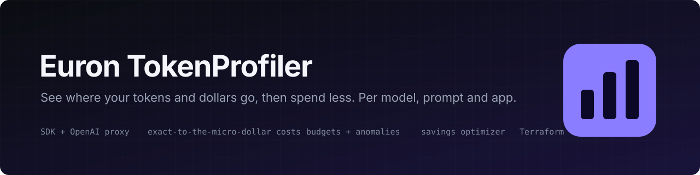
</p>

<p align="center">
  
  <a href="LICENSE"></a>
  
  
  
  
  
  
</p>

<p align="center">
  <a href="https://github.com/euron-sde-team/euron-tokenprofiler/stargazers"></a>
  <a href="https://github.com/euron-sde-team/euron-tokenprofiler/fork"></a>
  <a href="https://github.com/euron-sde-team/euron-tokenprofiler/watchers"></a>
  <br>
  <a href="https://github.com/euron-sde-team/euron-tokenprofiler/issues"></a>
  <a href="https://github.com/euron-sde-team/euron-tokenprofiler/pulls"></a>
  <a href="https://github.com/euron-sde-team/euron-tokenprofiler/commits/main"></a>
  
  <br>
  <a href="#built-by-the-team-behind-euron"></a>
</p>

<p align="center">
  <b><a href="#-quickstart">Quickstart</a></b> ·
  <b><a href="#️-architecture">Architecture</a></b> ·
  <b><a href="#-how-the-numbers-are-computed">How it works</a></b> ·
  <b><a href="#-use-it-from-your-app">Integrate</a></b> ·
  <b><a href="#️-deploy-to-aws">Deploy</a></b> ·
  <b><a href="docs/architecture/security.md">Security</a></b> ·
  <b><a href="#-documentation">Docs</a></b>
</p>

**Euron TokenProfiler** is an open-source, MIT-licensed AI token analytics tool, part of the open-source initiative of
**ENGAGESPHERE TECHNOLOGY PRIVATE LIMITED**. It tracks, analyzes and visualizes token consumption, API costs and usage
patterns across **models, prompts and applications**, and tells you specifically how to reduce them.

Record usage with a small Python SDK or by pointing any OpenAI client at the built-in **profiling proxy**. TokenProfiler
prices every call to the micro-dollar, shows where spend goes, forecasts the month, raises **budget and anomaly alerts**, and
its **optimizer** turns your real traffic into quantified recommendations: a cheaper model here, prompt caching there.

<p align="center">
  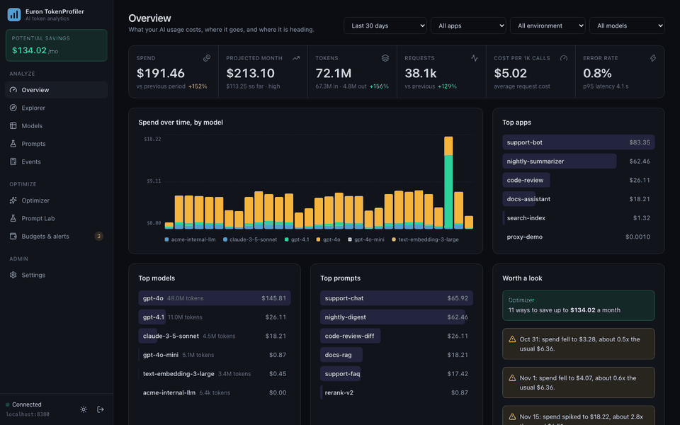
</p>

> [!NOTE]
> The tour is the real console running against the Docker Compose stack: **45 days of synthetic traffic (about 55k
> events)** sent through the ingest API and the proxy, with S3 and Secrets Manager emulated by Floci and provisioned by
> the same Terraform that builds production. Prices are approximate list prices, and the demo's provider is a mock.
> `make up && make demo` reproduces it.

<h3 align="center">Built by the team behind Euron</h3>

<p align="center">Euron TokenProfiler comes from the people who build these platforms. If you like how this repository is built, come and see what we build with it.</p>

<p align="center">
  <a href="https://euron.one"><picture><source media="(prefers-color-scheme: dark)" srcset="docs/assets/brand/euron-dark.svg"></picture></a>
  <a href="https://euronsystems.com"><picture><source media="(prefers-color-scheme: dark)" srcset="docs/assets/brand/euron-systems-dark.svg"></picture></a>
  <a href="https://alphaeuron.com"><picture><source media="(prefers-color-scheme: dark)" srcset="docs/assets/brand/alpha-euron-dark.svg"></picture></a>
</p>

<p align="center">
  <a href="https://www.instagram.com/euron_official"></a>
  <a href="https://www.linkedin.com/company/euronone/posts/"></a>
  <a href="https://x.com/euron712"></a>
  <a href="https://www.youtube.com/@Euron-official"></a>
  <a href="https://whatsapp.com/channel/0029VaeeJwq9RZAfPW9P2l07"></a>
</p>

---

## 📚 Table of contents

- [Why TokenProfiler](#-why-tokenprofiler) · [At a glance](#-at-a-glance) · [Screenshots](#️-screenshots) · [Features](#-features)
- [Architecture](#️-architecture) · [How the numbers are computed](#-how-the-numbers-are-computed) · [Tech stack](#-tech-stack)
- [Prerequisites](#-prerequisites) · [Quickstart](#-quickstart) · [Use it from your app](#-use-it-from-your-app)
- [Repository tour](#-explore-the-repository) · [API](#-api-at-a-glance) · [Configuration](#️-configuration) · [Deploy to AWS](#️-deploy-to-aws)
- [Security](#-security-model) · [Testing](#-testing) · [Documentation](#-documentation) · [Roadmap](#️-roadmap) · [FAQ](#-faq) · [License](#-contributing-security-and-license)

## 💡 Why TokenProfiler

Provider dashboards tell you the bill. They do not tell you **which prompt, app or model** caused it, whether a spike is
new, whether you will blow the budget by month end, or what to change.

- **Attribute spend** to model, app, environment, prompt template, user, session or any tag you send.
- **See it coming**: month-end forecast and budgets that warn on *projected* overrun, not just after the fact.
- **Act on it**: each recommendation shows its evidence, confidence, effort and estimated monthly saving.
- **Trust the numbers**: money is integer micro-dollars, ingestion is idempotent, estimates are always labelled.
- **Stay out of the way**: the SDK and proxy never block or fail your request because telemetry failed.

## 📊 At a glance

| | |
| --- | --- |
| Dimensions | app, environment, model, provider, endpoint, prompt, user, session, status, error type, finish reason, day, hour, any tag |
| Metrics | requests, errors, tokens (input, output, cached, cache-write), cost (input, output, cached), error cost, latency, savings |
| Ways in | Python SDK (OpenAI and Anthropic style wrappers), OpenAI-compatible proxy, `POST /v1/events` |
| Insights | forecast, budgets, anomaly detection, 8 optimizer rules, prompt analysis |
| Prices | 42 built-in approximate list prices, per-model overrides, unpriced models flagged |
| Storage | SQLite (WAL), one process, daily S3 backup on AWS |
| Tests | 284 Python and console unit/integration tests, 49 end-to-end checks, 8 chaos scenarios, 23 Chromium tests |

## 🖼️ Screenshots

Dark theme by default, light theme included, responsive down to a phone.

| | |
| --- | --- |
| 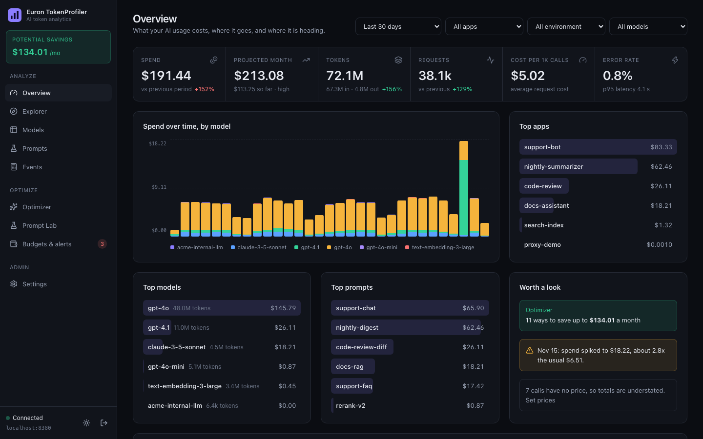<br>**Overview:** spend, projected month, tokens, trend by model, top apps, models and prompts | 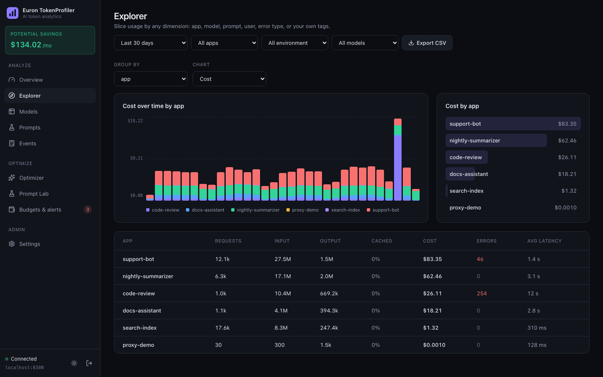<br>**Explorer:** group by any dimension or tag, sort, filter, export CSV |
| 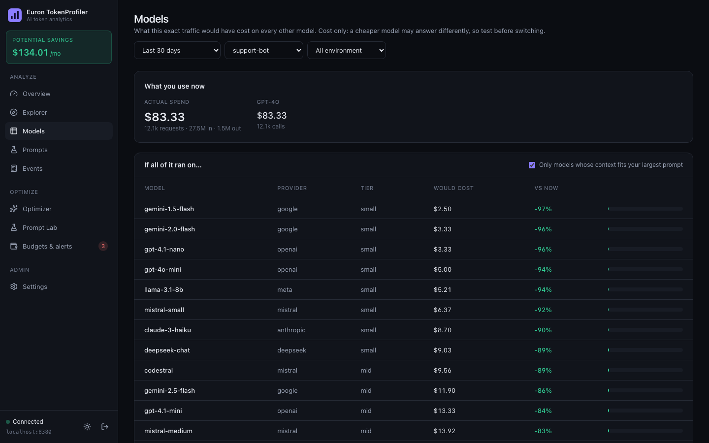<br>**Models:** what the same traffic would cost on every other model | 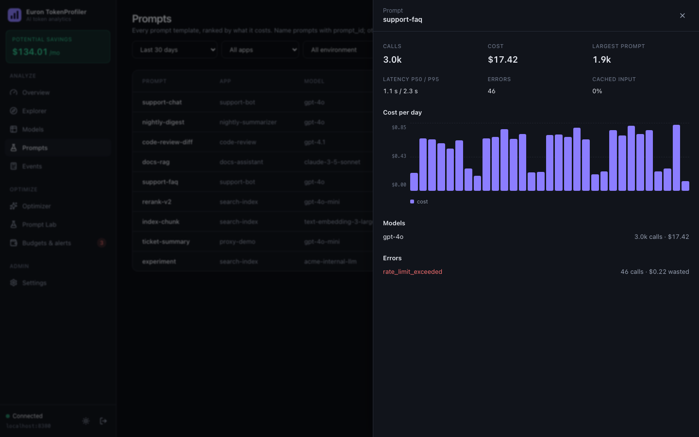<br>**Prompts:** templates ranked by spend, with model mix, latency and errors |
| 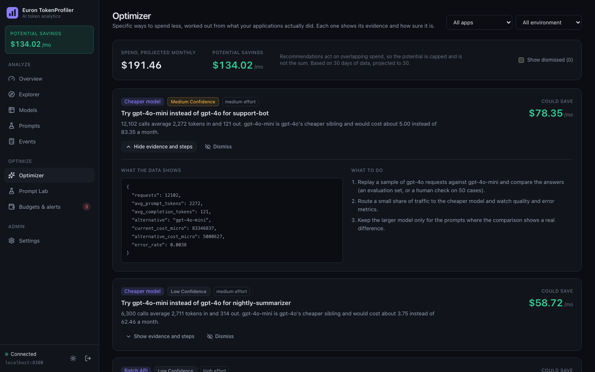<br>**Optimizer:** quantified recommendations with evidence and steps | 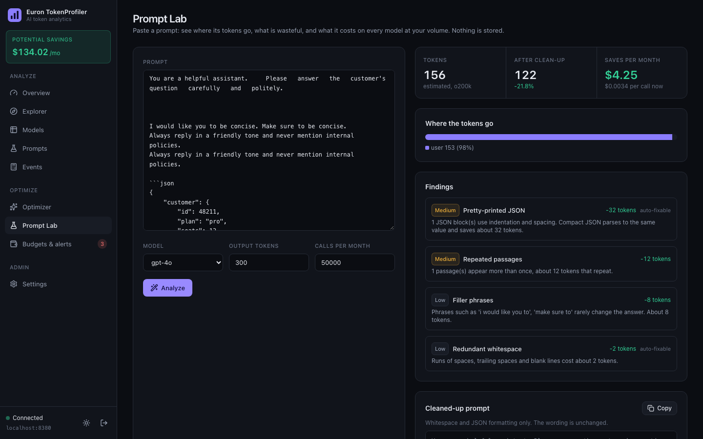<br>**Prompt Lab:** where a prompt's tokens go, what to trim, cost on every model |
| 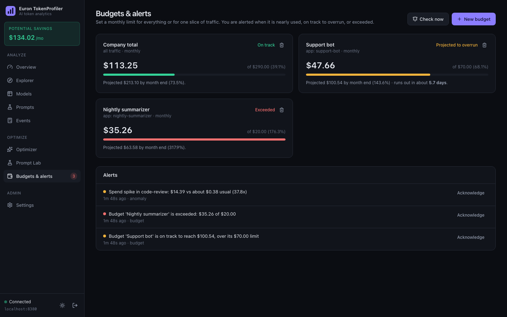<br>**Budgets and alerts:** status, projection, spikes, acknowledge | 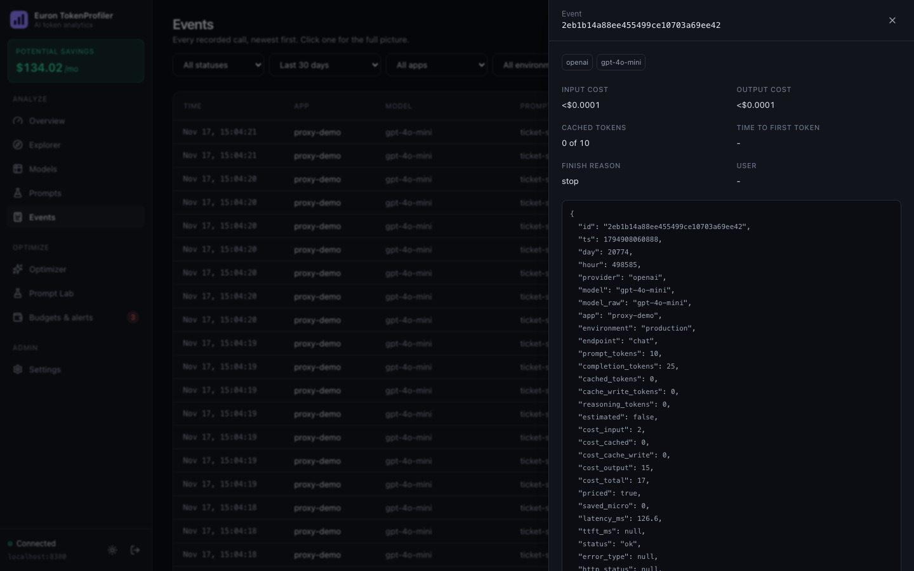<br>**Events:** every call, with cost split and a detail drawer |
| 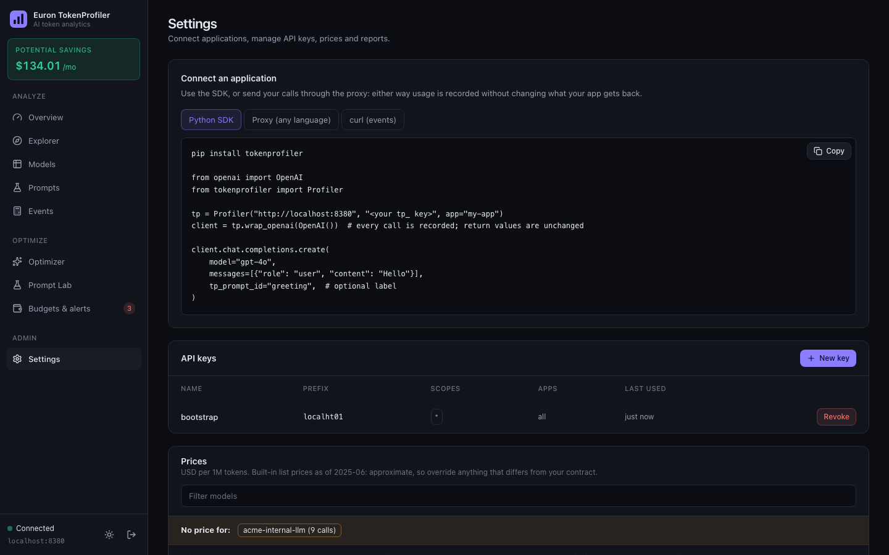<br>**Settings:** copy-paste snippets, scoped keys shown once, price overrides | 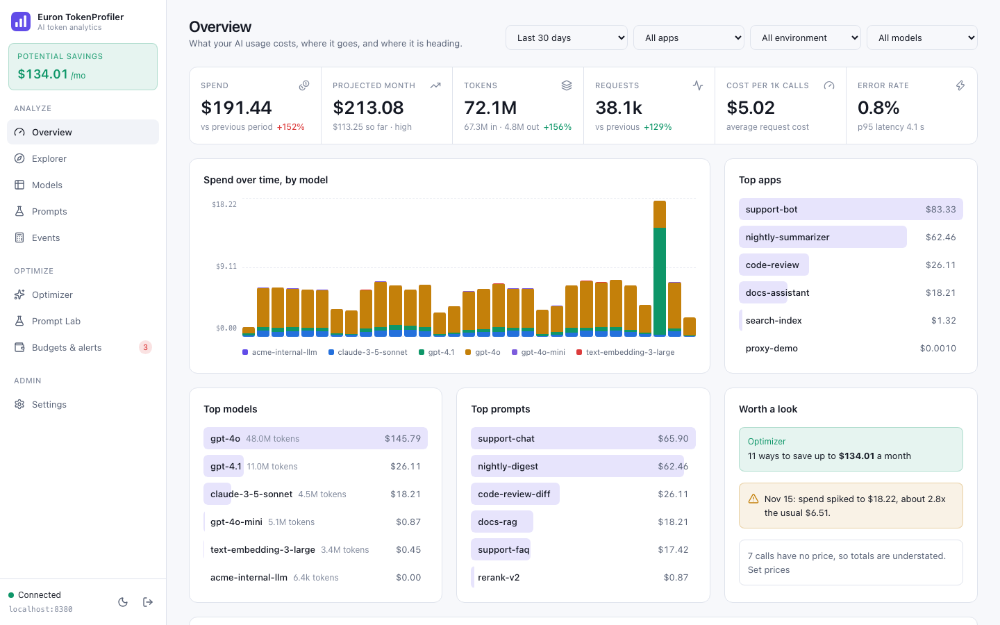<br>**Light theme:** follows your system, remembered per browser |

## ✨ Features

**Track**
- Python SDK with a bounded queue, background sending, retries and idempotent event ids
- OpenAI-compatible profiling proxy for chat and embeddings, including streaming; records failures too
- Token **estimation** when a provider reports none, always flagged as estimated; exact counts with `tiktoken` if installed

**Analyze**
- Overview, explorer (any dimension, any tag), model comparison, prompt templates (auto-grouped by shape), event log
- Latency percentiles, cache hit rates, error cost, CSV and JSON Lines export
- Pricing with prefix matching, overrides and re-pricing of history

**Optimize and protect**
- Optimizer: cheaper model, prompt caching, response cache, truncation, error waste, batch API, context growth, unpriced models
- Prompt Lab: token breakdown, wasteful patterns, a cleaned prompt, cost on every model
- Budgets (monthly, scoped), forecasts, spike detection, webhook alerts guarded against SSRF

**Operate**
- Scoped API keys (`ingest`, `read`, `budgets:write`, `pricing:write`, `admin`) with per-app allow-lists
- Terraform modules, Floci for local AWS, health checks, Prometheus metrics, daily backups, S3 report archive

## 🏗️ Architecture

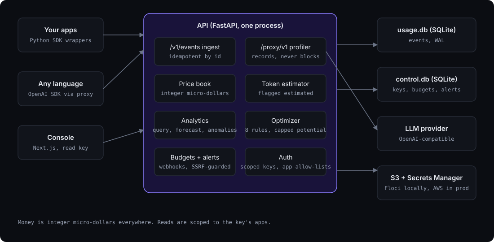

One FastAPI process owns two SQLite files. Usage arrives from the SDK or the proxy, is validated, priced and stored
idempotently; the console and API read it through a whitelisted query layer. Details: [HLD](docs/architecture/HLD.md),
[LLD](docs/architecture/LLD.md).

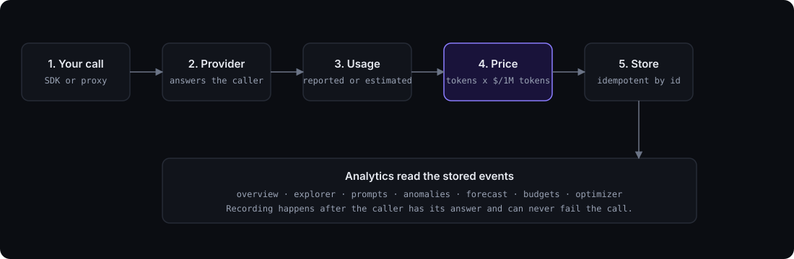

## 🧮 How the numbers are computed

- **Money** is integer **micro-dollars**. Prices are USD per 1M tokens, so `tokens × price` is already micro-dollars; rounding is half-up and matches SQL, so re-pricing history is exact ([ADR-0002](docs/architecture/adr/0002-integer-micro-dollars.md)).
- **Tokens**: provider-reported usage wins. Otherwise a calibrated BPE approximation estimates them (held-out error about 4 to 6%) and the event is marked `estimated` ([ADR-0003](docs/architecture/adr/0003-estimator-calibration.md)).
- **Forecast**: median daily run-rate to month end; a trend term only once there are 14 days of data.
- **Anomalies**: each day against the median and MAD of the previous 14 days, flagged only when statistically and practically large.
- **Savings**: each recommendation is estimated separately; the headline is capped at 70% of spend because rules overlap ([ADR-0004](docs/architecture/adr/0004-optimizer-overlap-cap.md)).

## 🧰 Tech stack

| Area | Choice |
| --- | --- |
| Backend | Python 3.12, FastAPI, Pydantic, SQLite (WAL), httpx |
| SDK | Python, stdlib threading, no required dependencies beyond httpx |
| Console | Next.js 15 (app router), TypeScript, TanStack Query, Tailwind |
| Infra | Terraform, Docker Compose, Floci (local AWS: S3, Secrets Manager, and more) |
| Quality | pytest, Vitest, Playwright, ruff, mypy (strict), ESLint |

## 📦 Prerequisites

Python 3.12, Node 22 with pnpm, and Docker for the full stack. No AWS account and no AI provider key are needed.

## 🚀 Quickstart

```bash
git clone https://github.com/euron-sde-team/euron-tokenprofiler.git && cd euron-tokenprofiler
make install     # virtualenv + dependencies
make up          # Floci, Terraform, API, mock provider, console
make demo        # 45 days of synthetic traffic, budgets, alerts
```

Open <http://localhost:3300>. API docs at <http://localhost:8380/docs>. Stop and wipe with `make down`.
Without Docker: `make dev` and `pnpm console:dev`. More in the [local quickstart](docs/guides/quickstart-local.md).

## 🔌 Use it from your app

**SDK**

```python
from openai import OpenAI
from tokenprofiler import Profiler

tp = Profiler("http://localhost:8380", "tp_...", app="support-bot")
client = tp.wrap_openai(OpenAI())  # every call is recorded; return values are unchanged
client.chat.completions.create(
    model="gpt-4o", messages=[{"role": "user", "content": "Hello"}], tp_prompt_id="greeting"
)
```

**Proxy (any language)**

```python
OpenAI(
    base_url="http://localhost:8380/proxy/v1",
    api_key="tp_...",
    default_headers={
        "X-Upstream-Api-Key": "<provider key>",
        "X-TP-App": "support-bot",
        "X-TP-Prompt-Id": "greeting",
    },
)
```

**Raw events**

```bash
curl localhost:8380/v1/events -H "Authorization: Bearer $TP_API_KEY" -H "Content-Type: application/json" \
  -d '{"events":[{"model":"gpt-4o","app":"my-app","prompt_tokens":1200,"completion_tokens":300,"latency_ms":840}]}'
```

See [integrating](docs/guides/integrate.md).

## 🧭 Explore the repository

```text
packages/core      pricing, token estimator, store, query, analytics, optimizer  (pure Python)
packages/sdk       the `tokenprofiler` client
apps/api           FastAPI: ingest, proxy, analytics, insights, admin, auth
apps/console       Next.js console
apps/mock-llm      deterministic OpenAI-compatible provider for tests and the demo
infra/terraform    modules and the local-floci, aws-dev, aws-prod environments
deploy/compose     Docker Compose stack
scripts/demo       seed data, e2e, chaos, tour GIF
e2e                Playwright browser tests and the screenshot generator
docs               architecture, ADRs, guides, OpenAPI
```

## 🔗 API at a glance

Full spec: [docs/api/openapi.yaml](docs/api/openapi.yaml), live at `/docs`.

| Method and path | Purpose |
| --- | --- |
| `POST /v1/events` | Record a batch of usage events (idempotent by id) |
| `POST /proxy/v1/chat/completions` · `/embeddings` | OpenAI-compatible, recorded |
| `GET /api/overview` | Spend, trend, forecast, top spenders |
| `GET /api/usage/summary` · `/timeseries` | Any metric grouped by up to three dimensions, or over time |
| `GET /api/prompts` · `/models/compare` · `/events` | Prompts, model what-ifs, event log |
| `GET /api/recommendations` | Optimizer, with dismiss and restore |
| `GET/POST /api/budgets` · `GET /api/alerts` | Budgets and alerts |
| `GET/PUT /api/pricing` · `POST /api/pricing/reprice` | Price book |
| `GET /api/export/events` | CSV or JSON Lines |
| `GET/POST/DELETE /api/keys` | Scoped keys (admin) |

Errors share one shape: `{"error": {"message", "type", "code", "request_id"}}`.

## ⚙️ Configuration

Environment variables with a `TP_` prefix. The ones you will touch first:

| Variable | Default | |
| --- | --- | --- |
| `TP_DATA_DIR` | `~/.tokenprofiler` | Where the databases live |
| `TP_API_KEY_PEPPER` | dev value | Change it in any shared deployment |
| `TP_UPSTREAM_BASE_URL` | none | Where the proxy forwards |
| `TP_RETENTION_DAYS` | `400` | Event retention |
| `TP_CORS_ORIGINS` | `http://localhost:3300` | Console origins |

All of them: [configuration guide](docs/guides/configuration.md).

## ☁️ Deploy to AWS

Terraform modules build a VPC, ALB, a size-one Auto Scaling group (IMDSv2, SSM), ECR, an encrypted reports bucket,
Secrets Manager, CloudWatch alarms and SNS. SQLite is backed up daily to S3 and restored on boot. The same modules run
against Floci locally.

> [!IMPORTANT]
> `aws-dev` and `aws-prod` are **validated, not applied**. Read the plan and costs first. See the [AWS guide](docs/guides/deploy-aws.md).

## 🔒 Security model

Scoped keys stored as HMAC hashes, per-app allow-lists enforced in the query layer, bounded and validated input,
whitelisted SQL, an SSRF guard on webhooks, CSV formula neutralisation, fail-closed secrets, and a console that renders
all stored text as text. Two isolation leaks were found by testing and fixed. See the [security model](docs/architecture/security.md).

## ✅ Testing

| Layer | Tool | Count |
| --- | --- | --- |
| Core: estimator, pricing, store, analytics, optimizer | pytest | 154 |
| SDK | pytest | 19 |
| API: ingest, proxy, security, analytics, admin | pytest | 85 |
| Mock provider | pytest | 8 |
| Console | Vitest | 18 |
| Full-stack end to end | Python + Compose + Floci | 49 checks |
| Chaos | Python + Compose + Floci | 8 scenarios |
| Browser | Chromium via Playwright | 23 |

Run `make test` for the unit and integration tests, and `make up && make demo && make e2e e2e-chaos e2e-browser` for the rest.

Bugs these found and fixed, each with a regression test: an optimizer that dropped a key's app allow-list; budgets and
alerts visible across apps; a startup crash loop when Secrets Manager restarted; a cache race that re-cached a stale
list; `INSERT OR IGNORE` hiding failures as duplicates; a +133% trend from 10 days of data. See [testing](docs/guides/testing.md).

## 📖 Documentation

- [High-level design](docs/architecture/HLD.md) · [Low-level design](docs/architecture/LLD.md) · [Security model](docs/architecture/security.md)
- Decisions: [ADR index](docs/architecture/adr/)
- Guides: [local quickstart](docs/guides/quickstart-local.md) · [configuration](docs/guides/configuration.md) · [integrating](docs/guides/integrate.md) · [using the optimizer](docs/guides/tuning.md) · [operations](docs/guides/operations.md) · [deploying to AWS](docs/guides/deploy-aws.md) · [testing](docs/guides/testing.md)
- [OpenAPI spec](docs/api/openapi.yaml) · [Changelog](CHANGELOG.md)

## 🗺️ Roadmap

- [ ] Anthropic- and Gemini-native proxy routes
- [ ] Pluggable storage (Postgres or ClickHouse) for very large histories
- [ ] Per-user and per-customer showback reports
- [ ] Schema migrations and a documented upgrade path
- [ ] Node and Go SDKs

## ❓ FAQ

<details>
<summary><b>Do you store my prompts?</b></summary>

No. If you send `prompt_text` it is used to estimate tokens and to compute a fingerprint and template shape, and is not
stored. Only metadata (model, app, tokens, cost, latency, labels you choose) is kept.
</details>

<details>
<summary><b>How accurate are the costs?</b></summary>

When the provider reports usage, token counts are exact and cost is exact **for the prices in the book**. Built-in prices
are approximate list prices (as of 2025-06): override them for your contract. Estimated counts are about 4 to 6% off and
are labelled.
</details>

<details>
<summary><b>Will it slow down or break my app?</b></summary>

No by design: the SDK queues and sends in the background, and the proxy records after answering. If TokenProfiler is
down, your calls still work and some telemetry is dropped (and counted).
</details>

<details>
<summary><b>How do I give a team a view of only its own apps?</b></summary>

Create a `read` key with an app allow-list. Every read, budget, alert and recommendation is restricted to those apps.
</details>

<details>
<summary><b>Is it production-ready?</b></summary>

It is built with production habits (tested failure paths, scoped keys, isolation tests, alarms), but it is a showcase
project: the AWS environments were validated and not applied, SQLite means one writer, and it has not carried real
production traffic. Read the [security model](docs/architecture/security.md) and test with your own load first.
</details>

## 🤝 Contributing, security and license

- **Contributing:** [CONTRIBUTING.md](CONTRIBUTING.md). Run `make lint typecheck test` first.
- **Security:** report privately, see [SECURITY.md](SECURITY.md).
- **Conduct:** [CODE_OF_CONDUCT.md](CODE_OF_CONDUCT.md).
- **License:** [MIT](LICENSE) © ENGAGESPHERE TECHNOLOGY PRIVATE LIMITED and the Euron TokenProfiler contributors.
