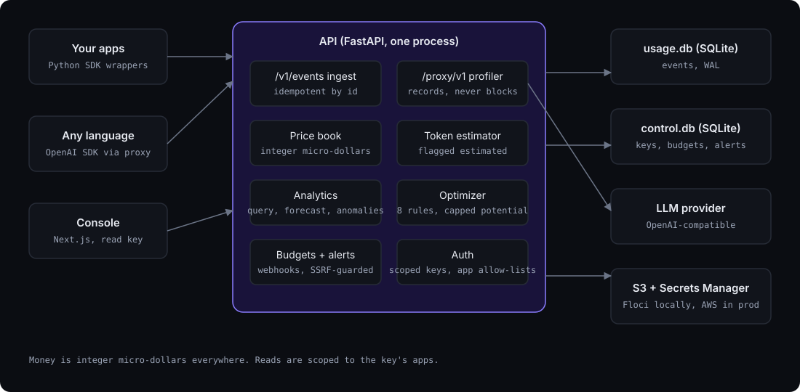
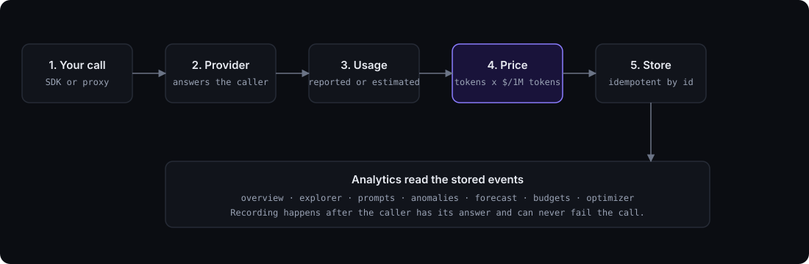

# High-level design

TokenProfiler answers three questions about LLM usage: **where do the tokens and dollars go**, **where is spend heading**,
and **what specifically would cut it**. It does this without sitting in your critical path.

## Components

| Component | Responsibility |
| --- | --- |
| `packages/core` | Pure logic, no web framework: token estimator, price book, event validation, query builder, SQLite store, anomaly detection, forecast, budgets, prompt analysis, the optimizer, demo data. |
| `apps/api` | FastAPI: ingestion, the OpenAI-compatible profiling proxy, analytics, insights, admin, scoped API keys, alerts, S3 report archive. |
| `packages/sdk` | `tokenprofiler` Python client: bounded background queue, retries, wrappers for OpenAI and Anthropic style clients. |
| `apps/console` | Next.js 15 console: overview, explorer, models, prompts, events, optimizer, prompt lab, budgets, settings. |
| `apps/mock-llm` | Deterministic OpenAI-compatible provider with prompt-cache simulation and failure triggers, used by tests and the demo. |
| `infra/terraform` | Modules (network, ecr, storage, secrets, alb, app-host, observability, notifications) and three environments. |

## Two ways in

1. **SDK** wraps your client. After your call returns, the usage is queued and sent in batches. A full queue drops the
   oldest event; telemetry never blocks or fails the request.
2. **Proxy**: point any OpenAI SDK at `/proxy/v1`. The API forwards the call, returns the answer, and records usage
   afterwards from a detached task. It always asks for streamed usage and hides it again unless the client asked.

Both produce the same `EventIn`, validated by the same code (`ingest.py`) and stored idempotently by event id.

## Data flow

1. Usage is taken from the provider response, or **estimated** (and flagged `estimated`) when absent.
2. The model name is normalised and priced from the price book. Costs are integer micro-dollars. A model with no price is
   stored as **unpriced**, never as zero.
3. The event is written to `usage.db`. Re-sending the same id is a no-op.
4. Reads aggregate with whitelisted SQL. Heavy dashboard queries are cached briefly, keyed by what the caller may see.
5. A background task evaluates budgets and anomalies and raises alerts (optionally to a webhook).

## State

Two SQLite databases (WAL): `usage.db` holds events, `control.db` holds keys, budgets, alerts, price overrides,
dismissed recommendations. One API process owns both. See [ADR-0001](adr/0001-single-process-sqlite.md).

## Deployment shapes

- **Local**: `make dev` (API on your machine) or `make up` (Compose: Terraform, API, mock provider, console, Floci).
- **AWS**: ALB in front of one EC2 instance in an Auto Scaling group of size one. SQLite is backed up daily to S3 and
  restored on boot. Secrets come from Secrets Manager. The AWS environments are validated, not applied.

## Non-goals

Multi-region or multi-writer storage, per-user billing, prompt content storage (prompt text is only used to estimate tokens and to compute a
fingerprint and template shape; the text itself is not stored), and replacing a provider's invoice as the source of truth.
